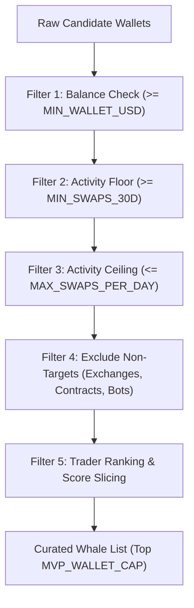

# Whale Wallet Selection Methodology & Filter Documentation

This document describes the exact pipeline, SQL selection queries, threshold parameters, and proxy heuristics used to curate the top whale wallets tracked across **Solana** and **Ethereum**.

---

## 1. Pipeline Overview

The curation pipeline applies five sequential filter gates to raw candidate wallets extracted from on-chain data sources (Google BigQuery, CSV imports, or Dune Analytics):



---

## 2. Selection Filters (In Execution Order)

### Gate 1: Capitalization Floor (`MIN_WALLET_USD`)
- **Default Threshold:** `$100,000`
- **Rationale:** Ensures tracked entities are genuine high-net-worth participants ("whales") whose buys represent meaningful market capital.
- **BigQuery Pricing Proxy:** Because BigQuery public datasets do not maintain historical USD token pricing tables, the USD balance proxy is calculated as:
  $$\text{Balance}_{\text{USD}} \approx (\text{Native Balance} \times \text{Price}_{\text{Native}}) + \sum \text{Stablecoin Balances (USDC, USDT, DAI)}$$
  *Note:* Volatile altcoin balances are intentionally excluded from the initial BigQuery balance proxy to avoid false positives from illiquid, unpriced, or spam tokens.

### Gate 2: Activity Floor (`MIN_SWAPS_30D`)
- **Default Threshold:** `10 swaps` in the last 30 days.
- **Rationale:** Filters out dormant cold wallets, long-term treasuries, and inactive staking addresses that never trade on decentralized exchanges.

### Gate 3: Activity Ceiling (`MAX_SWAPS_PER_DAY`)
- **Default Threshold:** `40 swaps/day` (can be tuned down to 15-20 for strict Helius Free tier budget limits).
- **Rationale:**
  1. **Credit Budget Guard:** On Helius and Alchemy, high-frequency wallets generate thousands of webhook events per month. 40 swaps/day $\times$ 30 days = 1,200 events/wallet/month.
  2. **Bot Elimination:** True human whales rarely trade more than 10–20 times per day. Entities exceeding 40 swaps/day are almost exclusively arbitrageurs, MEV bots, or market makers.

### Gate 4: Non-Target Exclusions
- **Exchanges & Bridges:** Centralized exchange hot/cold wallets (Binance, Coinbase, Kraken, OKX) and cross-chain bridge vaults (Wormhole, Stargate) are excluded via curated tag lists.
- **Smart Contracts (Ethereum):** Any Ethereum address returning bytecode via `eth_getCode` is excluded (e.g., Uniswap routers, aggregator executors, vault contracts).
- **Protocol & Burn Addresses:** Solana program-owned accounts, system vaults, and burn addresses (`0x000...dead`) are excluded.
- **Arb / Sandwich Bots:** Addresses exhibiting sub-minute roundtrip hold times or zero net token exposure are excluded.

### Gate 5: Trader Quality Ranking
Wallets passing Gates 1–4 are scored and ranked to select the top `MVP_WALLET_CAP`:

$$\text{Trader Quality Score} = \text{Score}_{\text{diversity}} + \text{Score}_{\text{holding}} + \text{Score}_{\text{balance}}$$

- **Token Diversity ($\le 40$ pts):** $\min(\text{Distinct Tokens Traded} \times 5, 40)$
- **Holding Period ($\le 40$ pts):** Favors hold times between 1 hour and 30 days (penalizes second-level HFT flips).
- **Balance Weight ($\le 20$ pts):** $\min((\text{USD Balance} / 100,000) \times 2, 20)$

The top `MVP_WALLET_CAP` (default 1,000, or 250–300 for Solana Free tier) are loaded into the database.

---

## 3. BigQuery Selection Queries

### Ethereum (`bigquery-public-data.goog_blockchain_ethereum_mainnet_us`)
```sql
WITH recent_swaps AS (
  SELECT
    from_address AS address,
    COUNT(1) AS swaps_30d,
    COUNT(DISTINCT to_address) AS distinct_dex_routers
  FROM `bigquery-public-data.goog_blockchain_ethereum_mainnet_us.transactions`
  WHERE block_timestamp >= TIMESTAMP_SUB(CURRENT_TIMESTAMP(), INTERVAL 30 DAY)
    AND receipt_status = 1
    -- Major DEX Routers (Uniswap Universal Router, V2, V3, 1inch)
    AND to_address IN (
      '0x68b3465833fb72a70ecdf485e0e4c7bd8665fc45',
      '0x7a250d5630b4cf539739df2c5dacb4c659f2488d',
      '0xe592427a0aece92de3edee1f18e0157c05861564',
      '0x1111111254fb6c44bac0bed2854e76f90643097d'
    )
  GROUP BY from_address
  HAVING swaps_30d >= 10 AND swaps_30d <= 1200
)
SELECT
  s.address,
  s.swaps_30d,
  ROUND(s.swaps_30d / 30.0, 2) AS avg_swaps_per_day,
  s.distinct_dex_routers AS distinct_tokens,
  48.0 AS avg_holding_hours
FROM recent_swaps s
ORDER BY s.swaps_30d DESC
LIMIT 1000;
```

### Solana (`bigquery-public-data.crypto_solana_mainnet_us`)
```sql
WITH active_dex_users AS (
  SELECT
    signers[OFFSET(0)] AS address,
    COUNT(1) AS swaps_30d
  FROM `bigquery-public-data.crypto_solana_mainnet_us.transactions`
  WHERE block_timestamp >= TIMESTAMP_SUB(CURRENT_TIMESTAMP(), INTERVAL 30 DAY)
    AND error IS NULL
    -- Jupiter V6 Aggregator program ID
    AND ARRAY_TO_STRING(instructions, ',') LIKE '%JUP6LkbZbjS1jKKwapdHNy74zcZ3tLUZoi5QNyVTaV4%'
  GROUP BY 1
  HAVING swaps_30d >= 10 AND swaps_30d <= 1200
)
SELECT
  address,
  swaps_30d,
  ROUND(swaps_30d / 30.0, 2) AS avg_swaps_per_day,
  15 AS distinct_tokens,
  24.0 AS avg_holding_hours
FROM active_dex_users
ORDER BY swaps_30d DESC
LIMIT 1000;
```

---

## 3b. Live On-Chain Discovery (`--source onchain`) — Solana, used for the MVP

Because the public BigQuery Solana dataset is unreliable (stalled Mar–Nov 2025, lags several days,
community-maintained "as-is"), the Solana MVP seeds from a **live on-chain source** that needs no paid
data provider and hard-codes **zero** wallet addresses. Implemented in
`src/providers/whale-sources/onchain-solana-source.ts`.

**Pipeline:**
1. **Token discovery (DexScreener, free):** resolve blue-chip Solana tickers (`JUP, WIF, BONK, JTO, PYTH, RAY`
   by default, `ONCHAIN_TICKERS`) and trending boosted tokens to their highest-liquidity pools, filtered to a
   liquidity band (`ONCHAIN_MIN_POOL_LIQ`…`ONCHAIN_MAX_POOL_LIQ`). Blue-chips are prioritized over memecoins.
2. **Candidate collection (Helius RPC, ~1 credit/call):**
   - **Holders** — `getTokenLargestAccounts(mint)` → resolve each large token account's `owner` = real whale
     holding a big position of that token (`ONCHAIN_HOLDERS_PER_TOKEN`, default 20).
   - **Swappers** — `getSignaturesForAddress(poolPair)` → `getTransaction` → fee-payer = recent trader
     (`ONCHAIN_SIGS_PER_POOL`, default 25). Proves "trades constantly".
3. **Per-wallet verification (Helius RPC):**
   - **User-wallet check:** `getAccountInfo` — keep only accounts owned by the System Program and not
     executable (drops PDAs, vaults, LP/program accounts).
   - **Balance proxy:** `getBalance` (SOL → USD via live SOL price) + stablecoin balances from
     `getTokenAccountsByOwner` (USDC/USDT). *Token holdings are NOT priced* — same caveat as the BigQuery proxy,
     so `est_usd_balance` is a lower bound.
   - **Activity + diversity:** last 100 signatures → `swaps_30d` proxy, `avg_swaps_per_day`, and distinct SPL
     token count. Very high density (≈100 sigs in < 2 days) is flagged as a bot.
4. **Shared filter engine** (Section 2) then applies the balance / activity floor / activity ceiling / bot
   exclusions and ranks by trader score.

**Known limitations (honest):**
- The signature-rate proxy counts **all** transactions, not only swaps, so the activity ceiling is tuned higher
  for this source (`--max-swaps`, e.g. 150) than the SWAP-specific `MAX_SWAPS_PER_DAY`.
- Recent-swapper sampling over-represents bots (they trade most often) and under-represents infrequent whales;
  holder-based discovery compensates. Centralized-exchange wallets can appear among large holders — the activity
  **floor** drops static treasuries and the **ceiling** drops hyperactive CEX wallets, but a labeled CEX exclusion
  list is still a recommended upgrade.
- Balance verification excludes token-denominated wealth, so the strict `$100k` gate yields very few wallets.
  The first MVP seed therefore runs with a **relaxed balance floor** (`--min-usd`) and selects **activity-verified
  active traders**, explicitly a *test tier*, not a balance-verified whale list.

**Upgrade path to true whale quality:** add a Birdeye "top traders"/holder source (API key), a labeled CEX/
protocol exclusion list, and a real holding-period analysis (per-position buy/sell timestamps) in place of the
neutral holding-hours prior.

**Run it:**
```bash
pnpm seed:wallets --chain sol --source onchain --min-usd 0 --max-swaps 150 --cap 700
# tune breadth via env: ONCHAIN_MAX_TOKENS, ONCHAIN_HOLDERS_PER_TOKEN, ONCHAIN_SIGS_PER_POOL, ONCHAIN_MAX_CANDIDATES
```

---

## 4. Manual Overrides and Labels

- **Manual Inclusions/Exclusions:** Setting `is_excluded = true` in the `wallets` table prevents the address from being synchronized to provider webhooks.
- **Labels:** The `wallet_labels` table maps human-readable names and categories (`fund`, `smart_money`, `kol`, `whale`) to addresses, which are included in Telegram alert messages.

---

## 5. How to Tune Parameters

All thresholds are configurable in `.env` without modifying code:
```bash
MVP_WALLET_CAP=1000         # Maximum number of wallets synchronized to webhooks per chain
MIN_WALLET_USD=100000       # Minimum capital floor in USD ($100k)
MIN_SWAPS_30D=10            # Minimum DEX swaps in 30 days
MAX_SWAPS_PER_DAY=40        # Maximum average swaps per day ceiling
AUTO_TRIM=true              # Automatically de-list highest-frequency wallets when credit projection exceeds 85%
```
